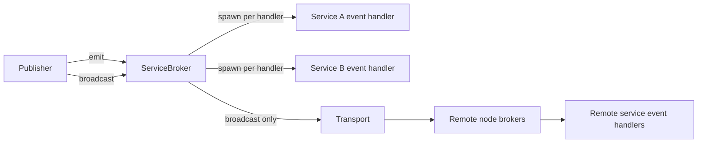
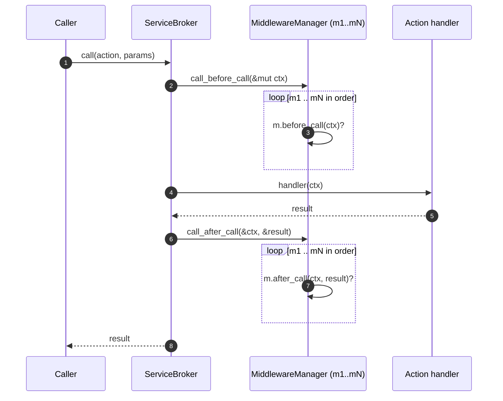
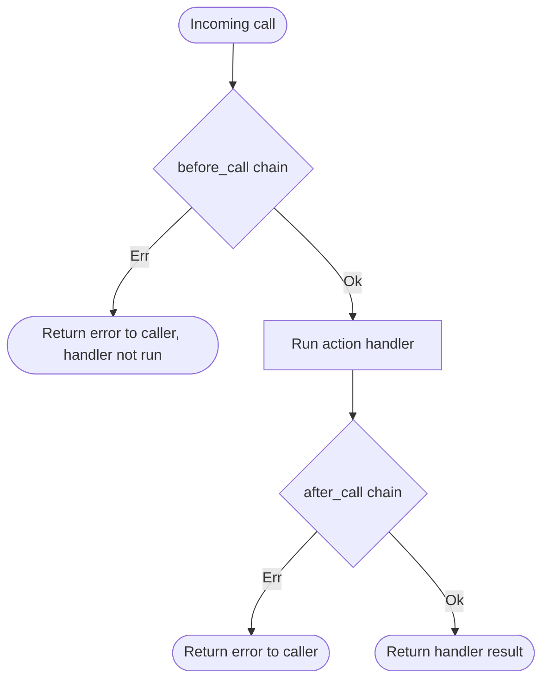

# Events and Middleware

This document describes the event bus and the middleware hook pipeline. It
separates what the code does today from what the design intends, because the
two differ (see [overview.md](./overview.md#known-gaps)).

## Event bus

Events are named strings (for example `user.created`). Each service declares
handlers in `schema.events`. Publishers use one of two calls.

| Call | Local services | Remote nodes | Waits for handlers |
|------|----------------|--------------|--------------------|
| `broker.emit(name, payload)` | Yes, each matching handler on a spawned task | No (G4) | No |
| `broker.broadcast(name, payload)` | Yes, same as `emit` | Yes, via `transport.broadcast` | No (local); transport decides (remote) |

### Event handler failures

Handler errors are logged with `log::error!` and are not returned to the
publisher. Publishers who need delivery guarantees must use a transport with
acknowledgements and must check results in their own code.

### Internal broker events

`ServiceBroker` also has an internal `broadcast::Sender<InternalEvent>`
(`src/broker.rs`). Only `ServiceStarted` is sent, and no subscriber exists in
the crate. Treat it as an extension point, not as a public event API, until a
subscription method is added.

## Middleware hook pipeline

The `Middleware` trait (`src/middleware.rs`) defines seven hooks. All have
default no-op implementations.

| Hook | Receives | Called by (intended) | Can abort? |
|------|----------|----------------------|------------|
| `service_created` | service name | `call_service_created` | Yes |
| `service_started` | service name | `call_service_started` | Yes |
| `service_stopped` | service name | `call_service_stopped` | Yes |
| `before_call` | `&mut Context` | `call_before_call` | Yes |
| `after_call` | `&Context`, `&Result<Value>` | `call_after_call` | Yes |
| `before_emit` | `&mut Context` | `call_before_emit` | Yes |
| `after_emit` | `&Context` | `call_after_emit` | Yes |

`MiddlewareManager` runs hooks in registration order. The first `Err` stops the
chain and is returned to the caller.

### Intended action pipeline

### Current behaviour

Today `ServiceBroker` does not hold a `MiddlewareManager`. The steps above do
not run, and middleware does not change call results, timeouts, or
authorization decisions (G1). The built-in middlewares (`LoggingMiddleware`,
`MetricsMiddleware`, `AuthMiddleware`, `RateLimitMiddleware`, `CacheMiddleware`)
only take effect once the broker calls the manager.

### Decision flow for an incoming call (target state)

## Implementation checklist for wiring middleware

Track this as work under G1. Do not mark it done until a test shows each hook runs.

1. Add `middleware: Arc<RwLock<MiddlewareManager>>` to `ServiceBroker`, with a `use_middleware` method.
2. Call `call_before_call` and `call_after_call` in `call_with_options`, for both local and remote paths.
3. Call `call_before_emit` and `call_after_emit` in `emit`.
4. Call `call_service_created`, `call_service_started`, `call_service_stopped` in the matching broker methods.
5. Add integration tests in `tests/integration/` that assert hook order and abort behaviour.
6. Record the decision in an ADR under `docs/architecture/adr/`.
