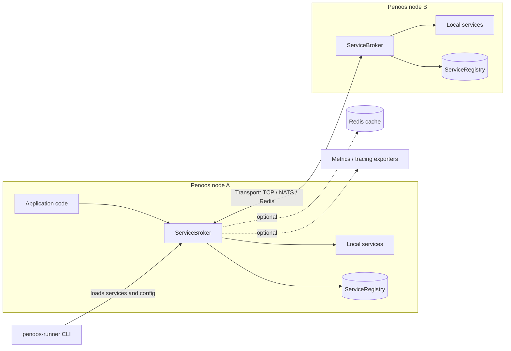
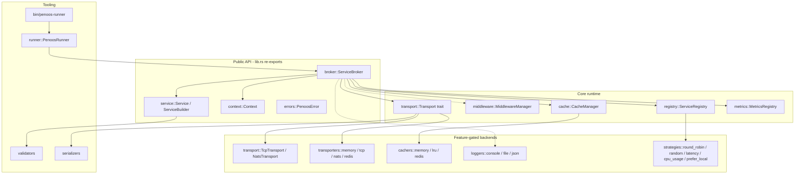

# Penoos Architecture Overview

Penoos is a Rust microservices framework inspired by MoleculerJS. It provides a
service broker that routes **actions** (request/response) and **events**
(publish/subscribe) between services, either inside one process or across nodes
through a transporter.

This document is the entry point for architecture. Detailed flows live in:

- [request-lifecycle.md](./request-lifecycle.md): action calls, events, batch calls (sequence diagrams)
- [service-lifecycle.md](./service-lifecycle.md): broker and service state machines, startup and shutdown
- [events-and-middleware.md](./events-and-middleware.md): event bus and middleware hook pipeline
- [transports.md](./transports.md): transport abstractions, packets, deployment topologies
- [PENOOS_SUMMARY.md](./PENOOS_SUMMARY.md) and [../runner/RUST_RUNNER_SUMMARY.md](../runner/RUST_RUNNER_SUMMARY.md): historical feature summaries

## Goals and constraints

| Goal | How the design serves it |
|------|--------------------------|
| Async, high concurrency | Tokio runtime; `async-trait` transport contracts; `DashMap` and `parking_lot` for shared state |
| Location transparency | `broker.call("svc.action", params)` is the same call for local and remote actions |
| Pluggable infrastructure | Transports, caches, loggers, and load-balancing strategies are traits with feature-gated backends |
| Simple core | One broker type, one `Service` builder, one `Context` per invocation |

## System context

## Layered view of the crate

Solid arrows are wired in the current code. Dashed arrows are declared but
**not connected to the call path** (see [Known gaps](#known-gaps)).

## Module map

| Path | Responsibility | Status |
|------|----------------|--------|
| `src/broker.rs` | `ServiceBroker`: start/stop, `call`, `mcall`, `emit`, `broadcast`, service registration | Wired |
| `src/service.rs` | `Service`, `ServiceSchema`, `ServiceBuilder`, action and event handler types | Wired |
| `src/context.rs` | `Context`: node id, action or event name, params, meta | Wired |
| `src/registry.rs` | `ServiceRegistry`: service and node records, load-balancing selection | Wired |
| `src/transport.rs` | `Transport` trait, `TransportPacket`, `LocalTransport`, `TcpTransport`, `NatsTransport` | Used by broker |
| `src/transporters/` | `Transporter` trait (publish, subscribe, request) with memory, tcp, nats, redis modules | Not connected to broker |
| `src/middleware.rs` | `Middleware` trait, `MiddlewareManager`, built-in logging, metrics, auth, rate-limit, cache middlewares | Hooks defined, not invoked by broker |
| `src/mixins.rs` | Reusable service behaviour | Available |
| `src/cache.rs`, `src/cachers/` | `CacheBackend` trait and implementations | Available |
| `src/strategies/` | Endpoint selection strategies | Available |
| `src/loggers/`, `src/tracing.rs`, `src/metrics.rs`, `src/reporters.rs` | Observability | Available |
| `src/runner.rs`, `src/bin/penoos-runner.rs` | CLI that loads config and services, starts a broker, waits for shutdown | Wired |
| `src/errors.rs`, `src/validators.rs`, `src/serializers.rs`, `src/utils.rs`, `src/constants.rs` | Shared support | Available |
| `src/lib_old.rs`, `src/lib_new.rs` | Not referenced by `src/lib.rs` | **Dead code, candidates for removal** |
| `src/middlewares/`, `src/metrics/`, `src/registry/`, `src/validators/`, `src/serializers/`, `modules/`, `test/*`, `benchmark/*` | Empty directories | Placeholders |
| `examples/` | Runnable examples (`hello_world`, `math_service`, Docker and multi-node samples) | Examples |

## Key design decisions

1. **One broker, many services.** A broker owns the registry, the transport, and
   the service list. Services are values built with `Service::new(name)` and
   registered with `create_service`.
2. **Actions are looked up in a flat map.** `create_service` inserts each action
   under `"<service>.<action>"` into a `DashMap`. Local dispatch is one map lookup.
3. **Local first, remote fallback.** `call_with_options` dispatches to a local
   handler when one exists and otherwise delegates to the configured `Transport`.
4. **Events are fan-out.** `emit` runs local event handlers on spawned tasks;
   `broadcast` additionally forwards the event to the transport.
5. **Transport is a trait object.** The broker holds
   `Option<Arc<dyn Transport + Send + Sync>>`, so single-node use needs no network.
6. **Protocol compatibility is a goal, not a guarantee.** `PROTOCOL_VERSION` is
   `"5"` in `src/lib.rs`. Wire compatibility with MoleculerJS nodes must be
   verified by tests before it is claimed.

## Known gaps

These were verified against the source when this document was written. Each one
changes behaviour that users may rely on, so fixes go through an issue and an ADR first.

| # | Gap | Evidence | Impact |
|---|-----|----------|--------|
| G1 | `MiddlewareManager` is never called from `ServiceBroker` | `grep MiddlewareManager src/broker.rs` returns nothing | Middleware hooks (`before_call`, `after_call`, `before_emit`) never run |
| G2 | Local calls ignore `CallOptions` (timeout, retries) | `call_with_options` returns `handler(context)` directly | Timeouts and retries apply only to remote calls |
| G3 | Two transport abstractions | `transport::Transport` (used by broker) vs `transporters::Transporter` (unused by broker) | Duplicated concepts; unclear which backend is supported |
| G4 | `emit` is local-only | `broker.rs` `emit` iterates only `self.services` | Remote subscribers receive events only via `broadcast` |
| G5 | Dead files | `src/lib_old.rs`, `src/lib_new.rs` not in module tree | Confusing for readers and search tools |
| G6 | TCP transport panics | `TcpTransport::call`, `broadcast`, `send_to_node` are `todo!()` | A remote call can panic at runtime |
| G7 | Transporter backends are stubs | `src/transporters/{tcp,nats,redis}.rs` contain TODO placeholders and are not wired to the broker | No working discovery, heartbeat, or pub/sub backend |
| G8 | Placeholder module directories | Empty `src/middlewares/{debugging,transmit}`, `src/metrics/{reporters,types}`, `src/registry/discoverers`, `src/validators`, `test/{unit,e2e,integration}`, `benchmark/{suites,data}`; `src/serializers/` (empty, sibling of `serializers.rs`) | Misleading structure; `test/` is not auto-discovered by Cargo |

Details for G1, G3, G4, G6, and G7 are in [events-and-middleware.md](./events-and-middleware.md)
and [transports.md](./transports.md).

See [../engineering/health-report.md](../engineering/health-report.md) for the
lint, format, and test baseline.
