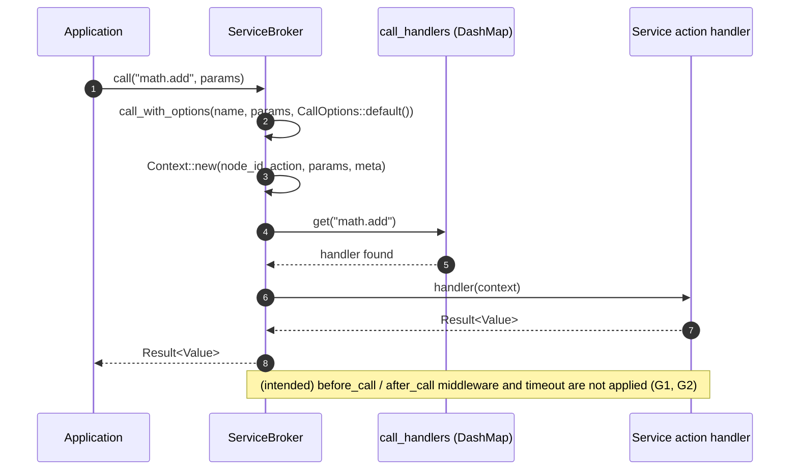
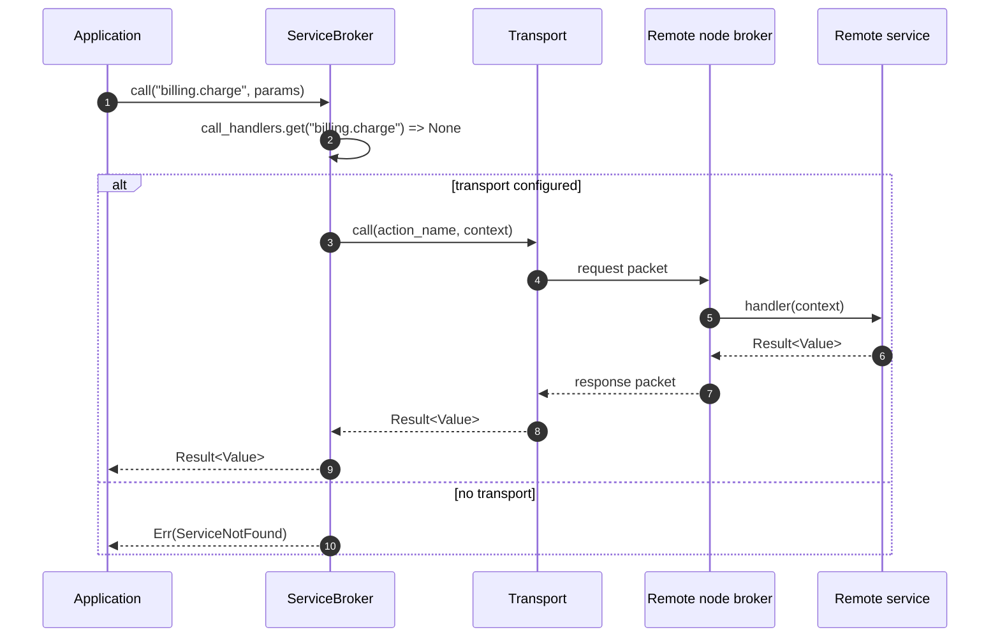
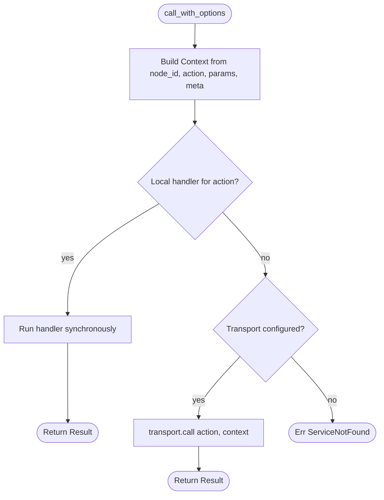
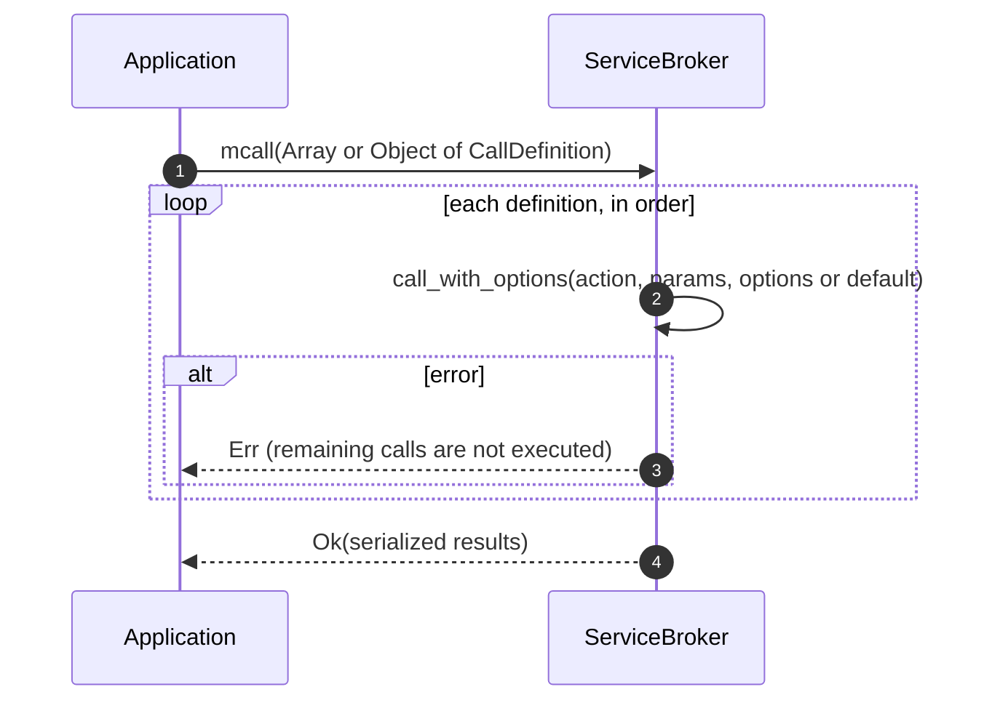
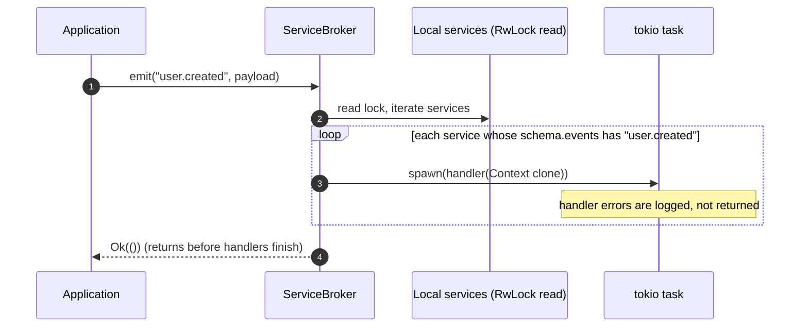
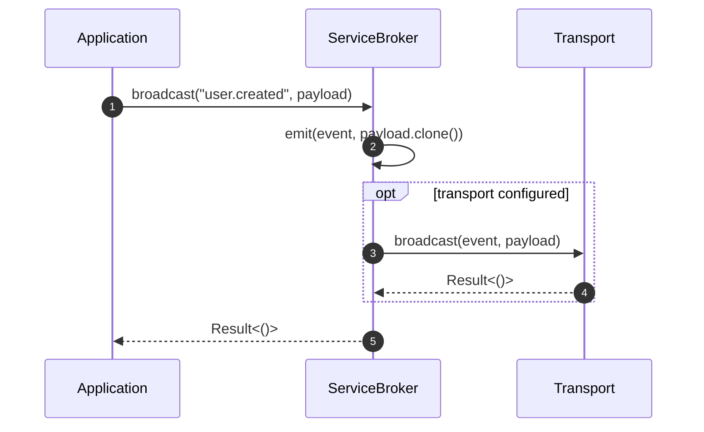

# Request Lifecycle

This document describes how actions and events move through the broker. Each
diagram matches the code path named in its heading. Steps marked **(intended)**
are defined in the design but not yet connected; see [overview.md](./overview.md#known-gaps).

## 1. Local action call

`broker.call(name, params)` delegates to `call_with_options` with default options.



## 2. Remote action call

When no local handler exists, the broker delegates to the transport.



## 3. Decision logic for `call_with_options`



## 4. Batch calls (`mcall`)

`mcall` runs each definition in order and stops at the first error with `?`.
Array input returns a JSON array; object input returns a JSON object keyed by
the original keys.



Calls run **sequentially**. Parallel fan-out is not implemented; callers that
need it should use `tokio::join!` over `call` futures.

## 5. Event emit (local fan-out)



`emit` does not wait for handlers and does not report handler failure to the caller.

## 6. Broadcast (local plus transport)



Remote delivery depends on the transport implementation and on remote nodes
subscribing to the event. Local `emit` is never forwarded to remote nodes on its own (G4).

## 7. Middleware pipeline (intended)

This is the target order from `src/middleware.rs`. It is **not executed today**
because `ServiceBroker` never constructs or calls `MiddlewareManager` (G1).

```mermaid
sequenceDiagram
    autonumber
    participant B as ServiceBroker
    participant M as MiddlewareManager
    participant H as Action handler

    B->>M: call_before_call(&mut ctx)
    Note over M: Middleware run in registration order; first Err aborts the call
    M-->>B: Ok or Err
    B->>H: handler(ctx)
    H-->>B: result
    B->>M: call_after_call(&ctx, &result)
    M-->>B: Ok or Err
```

Event emission has matching hooks, `call_before_emit` and `call_after_emit`,
defined in the same manager. See [events-and-middleware.md](./events-and-middleware.md).
