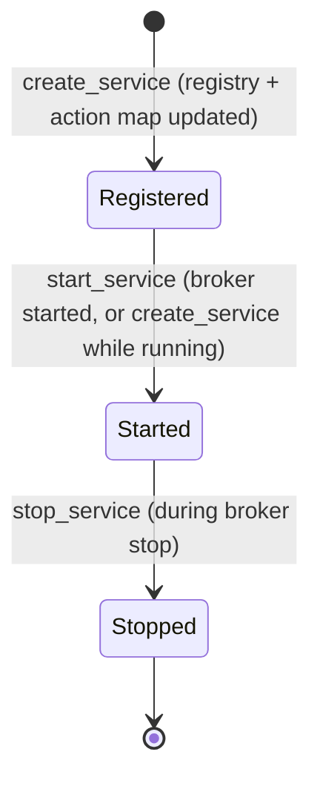
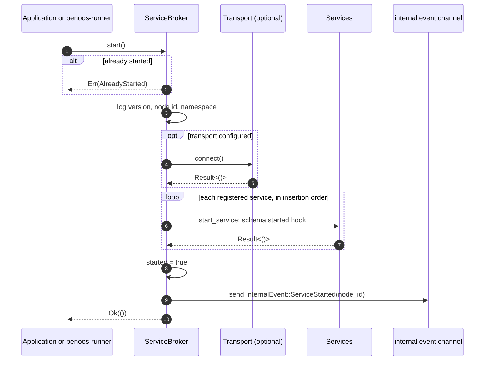
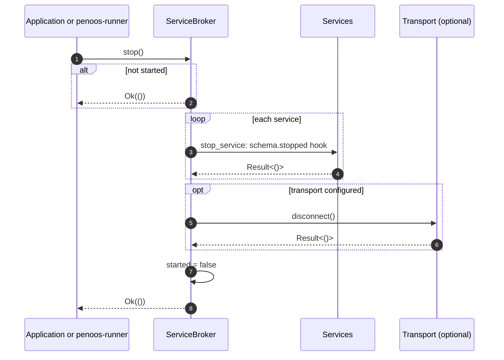
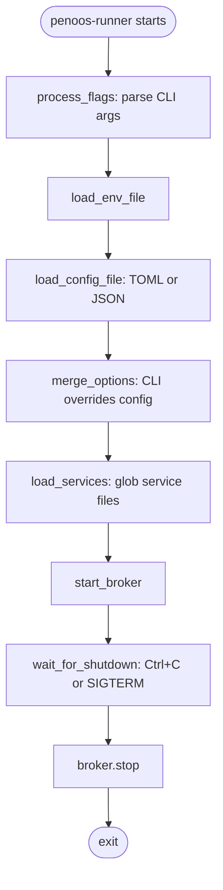

# Service and Broker Lifecycle

This document covers how a broker and its services move between states, and
the order of work during startup and shutdown. Source references:
`src/broker.rs` (`start`, `stop`, `create_service`, `start_service`, `stop_service`)
and `src/runner.rs` (CLI-driven startup).

## Broker states

```mermaid
stateDiagram-v2
    [*] --> Created: ServiceBroker::new / with_config
    Created --> Created: create_service (registers service, not yet started)
    Created --> Starting: start()
    Starting --> Running: transport connected, all services started
    Starting --> Created: error (returned to caller)
    Running --> Running: create_service (started immediately)
    Running --> Stopping: stop()
    Stopping --> Stopped: services stopped, transport disconnected
    Stopped --> Starting: start() again
    Stopped --> [*]: drop
```

`start()` returns `PenoosError::AlreadyStarted` when the broker is already running.
`stop()` on a stopped broker returns `Ok(())` without side effects.

## Service states

A service has no explicit state field. Its state is derived from the broker's
started flag and the service's lifecycle hooks.



`start_service` invokes the optional `schema.started` hook. `stop_service`
invokes `schema.stopped`. A hook error aborts the operation and is returned to the caller.

## Startup sequence



## Registration while running

`create_service` on a running broker registers the service, inserts its actions
into the call map, and starts it right away. A service created before `start()`
is started by `start()`.

## Shutdown sequence



Services are stopped before the transport is disconnected, so stop hooks can
still reach remote peers.

## CLI-driven lifecycle (`penoos-runner`)

The runner wraps the broker with configuration loading and signal handling.



Source: `src/runner.rs` lines 53, 139, 177, 291, 329, 479, 527.

## Lifecycle hooks versus middleware

Service hooks (`schema.started`, `schema.stopped`) run today. The matching
`MiddlewareManager::call_service_started` and `call_service_stopped` calls are
not connected, so middleware lifecycle hooks do not run (see
[events-and-middleware.md](./events-and-middleware.md)).
