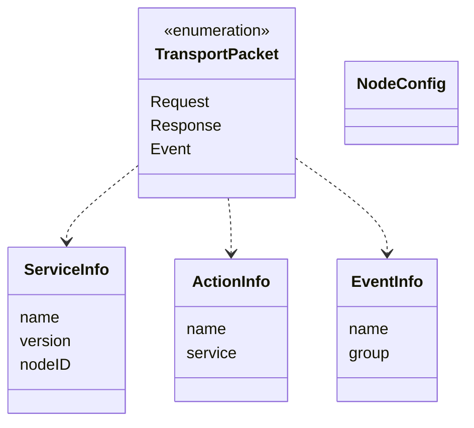
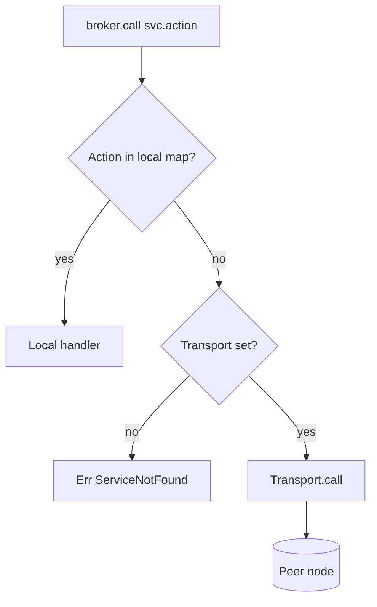
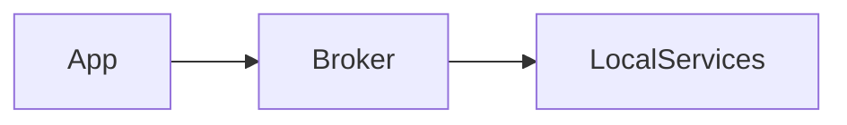
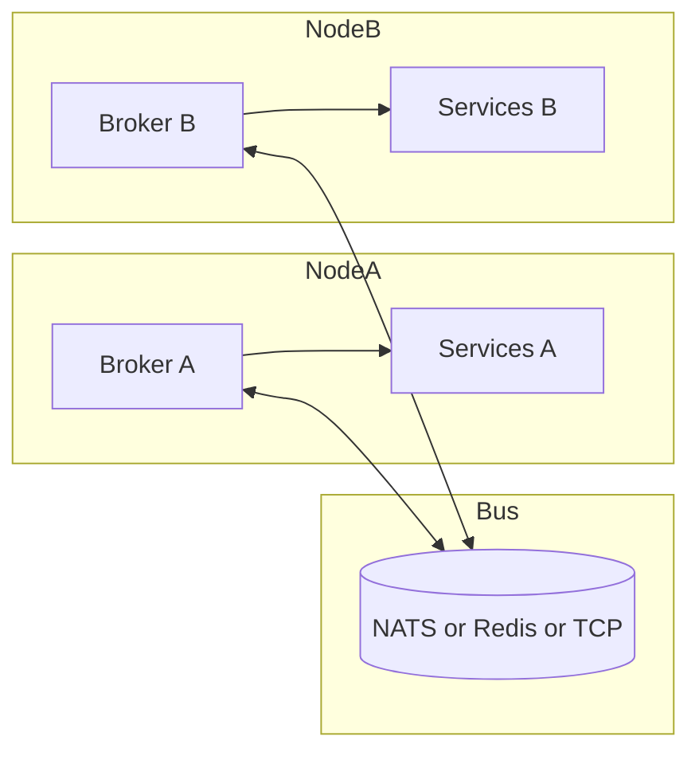

# Transports

A transport carries action calls and events between broker instances on
different nodes. This document describes the abstractions, the packet model,
the backend status, and the supported topologies.

## Two abstractions (G3)

The codebase has two transport traits. Only one is used by the broker.

| Trait | Module | Used by broker | Methods (summary) |
|-------|--------|----------------|-------------------|
| `Transport` | `src/transport.rs` | **Yes**, `ServiceBroker.transport: Option<Arc<dyn Transport>>` | `connect`, `disconnect`, `call`, `broadcast`, `send_to_node`, `is_connected` |
| `Transporter` | `src/transporters/mod.rs` | No | `connect`, `publish`, `subscribe`, `request`, `discover`, `register_node`, `unregister_node`, `heartbeat`, `get_stats` |

The `Transporter` trait is the richer, Moleculer-style contract (discovery,
heartbeats, groups). The `Transport` trait is what the broker can call today.
Unifying them is tracked under G3. Until then, new backends must implement
`Transport`, and discovery features belong to `Transporter`.

## Packet model

`TransportPacket` in `src/transport.rs` has three variants, which map onto the
request, response, and event flows.

Packet payloads serialize with the serializers in `src/serializers.rs`. JSON is
always available. Each binary codec is opt-in behind its own feature flag:

| Serializer | Feature flag | Content type | Encoding |
|------------|--------------|--------------|----------|
| `json` | (always on) | `application/json` | JSON text |
| `msgpack` | `msgpack` | `application/msgpack` | MessagePack via `rmp-serde` |
| `oxicode` | `oxicode-serializer` | `application/octet-stream` | Compact binary via oxicode serde, standard config |
| `wincode` | `wincode-serializer` | `application/octet-stream` | JSON text framed by wincode (no serde integration) |
| `postcard` | `postcard-serializer` | `application/octet-stream` | Compact binary via postcard |

The binary codecs (`oxicode`, `postcard`) encode a `WireValue` mirror of
`serde_json::Value`, because `Value` needs `deserialize_any`, which non-self-describing
formats do not support.

## Backend status

| Backend | Feature flag | Compiles | `connect` | `call` / `broadcast` | Notes |
|---------|--------------|----------|-----------|-----------------------|-------|
| `LocalTransport` (`transport.rs`) | none | Yes | Yes | Yes (in-process) | Default for tests and single-node use |
| `TcpTransport` (`transport.rs`) | `tcp-transport` | Yes | Binds listener, no peer protocol | **`todo!()` panic** | Do not use in production |
| `NatsTransport` (`transport.rs`) | `nats-transport` | Yes | Flag only | Stub | No NATS client dependency yet (G7) |
| `transporters::memory` | none | Yes | Yes | Covered by 3 tests | In-process event bus |
| `transporters::tcp` / `nats` / `redis` | none | Yes | Stub | **`TODO` stubs** | Not wired to broker (G3, G7) |

Gap references: G6 (TCP `todo!` panic, NATS feature does not compile) and G7
(transporter stubs) are listed in [overview.md](./overview.md#known-gaps).

## Local versus remote dispatch

## Topologies

### Single node (no transport)

Actions and events stay in process. This is the only topology that works end to end today.

### Multi-node with a transport (target)

### Docker compose sample

`examples/docker/` runs a client container and a worker container. The worker
registers services and the client calls them over the configured transport. Use
it as a manual smoke test only, because the TCP and NATS paths are not
implemented yet.

## Rules for transport implementations

1. Never `todo!()` or `unimplemented!()` in a backend. Return `PenoosError` with a clear message so callers can handle it.
2. Honour `CallOptions.timeout` and retries at the broker layer (G2), not inside each backend.
3. Each backend must have integration tests under `tests/integration/transport_<name>.rs` that run two brokers and assert a round trip.
4. Feature-gated backends must compile under `cargo check --features <flag>` in CI (see [deployment.md](../engineering/deployment.md)).
